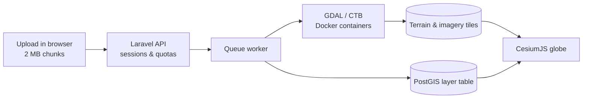

# Laravel CesiumJS 3D GIS Kit

A starter kit for building 3D WebGIS applications with **Laravel**, **CesiumJS** and **PostGIS**. Upload elevation models, orthophotos and vector data, let the queue convert them into Cesium-ready layers, and explore them on a 3D globe with measurement and terrain-analysis tools.

It is the open-source core extracted from a larger production WebGIS: the upload → conversion → 3D display pipeline, a data-management dashboard and the map tools, without project-specific features.

## Features

**Data pipeline**
- Resumable chunked uploads (2 MB chunks) with per-user quotas, disk-space checks and rate limits.
- **Terrain**: single-band DEM GeoTIFF → quantized-mesh terrain tiles (Cesium Terrain Builder), plus an optional orthophoto GeoTIFF → XYZ imagery tiles.
- **Vector**: GeoJSON, zipped Shapefile, DXF, DWG and Surpac STR → WGS84, stored as a dedicated PostGIS table per layer with the original attributes as columns. DXF colors are preserved.
- Converters (GDAL, CTB) run in network-less, read-only, resource-limited Docker containers.

**3D map**
- Layer panel grouped by category, terrain + orthophoto overlay, vector rendering with labels.
- Navigation: compass/north reset, zoom, pivot camera, geolocation, coordinate picker, live WGS84 cursor coordinates.
- Terrain depth test switch in the account menu: hides vector features behind hills or below the surface (remembered per browser).
- Measure toolbar: planar and surface distance, planar and surface area, circle radius/area.
- Vol/Profile analysis: cut & fill volume (flat, boundary or comparison terrain) and elevation profiles with an optional comparison terrain.
- Help popover with mouse, touch and keyboard hints.

**Administration**
- Two roles: **Admin** (upload, manage) and **Engineering** (view and analyse).
- Dashboard: overview, layer management (rename, recategorize, archive/restore, delete), layer categories with colors and icons.
- Session-based auth with throttled login, password reset (optional SMTP) and session invalidation on password change.

## Tech stack

| Layer | Technology |
|---|---|
| Backend | Laravel 13, PHP 8.3 |
| Database | PostgreSQL + PostGIS |
| Queue | Laravel queues (database driver by default) |
| Geoprocessing | GDAL, Cesium Terrain Builder (Docker) |
| Frontend | CesiumJS 1.140, Tailwind CSS 4, vanilla JavaScript, Vite |

## Quick start

Requirements: PHP 8.3+, Composer, Node.js 20+, PostgreSQL with PostGIS, Docker with Compose v2.

```bash
git clone <your-fork-url> laravel-cesiumjs-3d-gis-kit
cd laravel-cesiumjs-3d-gis-kit
cp .env.example .env            # set DB_DATABASE / DB_USERNAME / DB_PASSWORD
composer run setup              # install, key, migrate, seed, build
docker compose -f docker-compose.tools.yml pull
composer run dev                # server + queue worker + Vite
```

Open <http://localhost:8000> and log in with `admin` / `admin` (or `engineering` / `engineering`). These seeded passwords are for local development only; change them before exposing the app.

## Documentation

| Document | Contents |
|---|---|
| [Architecture](docs/architecture.md) | High-level overview, components, data model, status lifecycles, sequence diagrams for upload, conversion, viewing, analysis and deletion, frontend modules, security model. |
| [Development](docs/development.md) | Local setup, configuration reference, project structure, conventions, common tasks, testing, troubleshooting. |
| [Deployment](docs/deployment.md) | Deployment topology diagram, server setup (Nginx, PHP-FPM, PostgreSQL/PostGIS, Docker), queue worker and scheduler, updates, security checklist, backups, scaling. |

## How it works



See [docs/architecture.md](docs/architecture.md) for the detailed flows.

## Contributing

Issues and pull requests are welcome. Please:

1. Keep the frontend dependency-light: vanilla JavaScript, no jQuery, Alpine.js or Preline.
2. Run `vendor/bin/pint --dirty` and `npm run build` before opening a pull request.
3. Describe user-facing changes and update the docs in `docs/` when behaviour changes.

## License

Released under the [MIT License](LICENSE).

## Support and Donations

If you find this project useful and would like to support its further development, you can make a donation via the following platforms:

https://ko-fi.com/zakialawi
