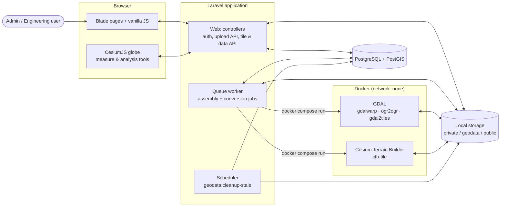
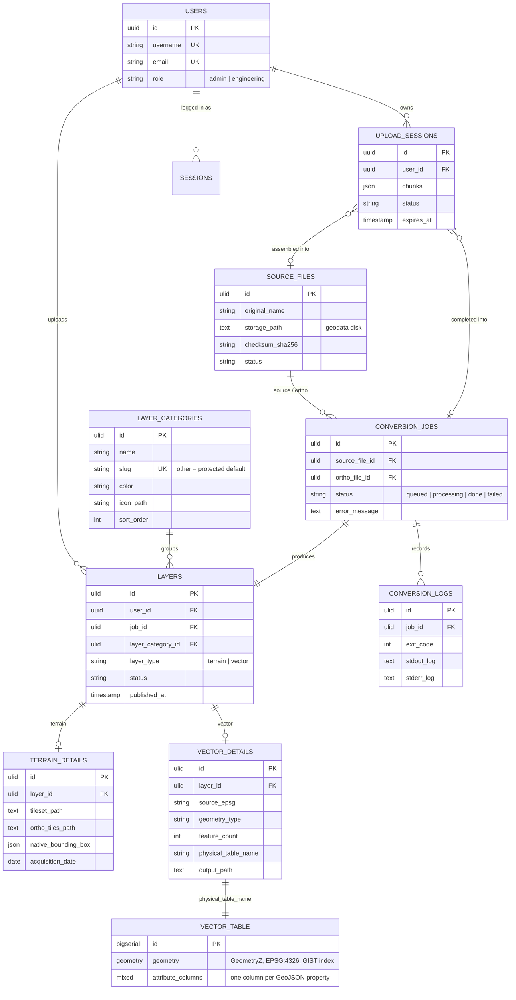
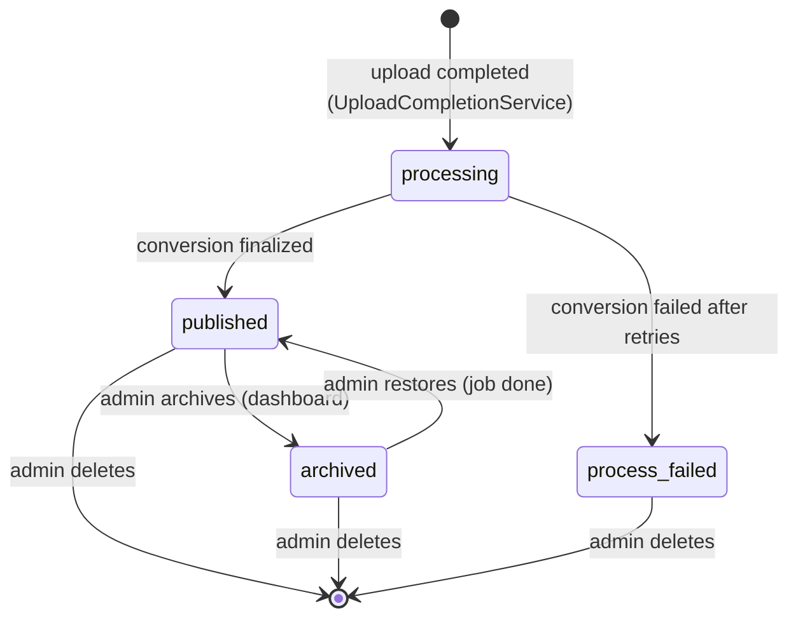
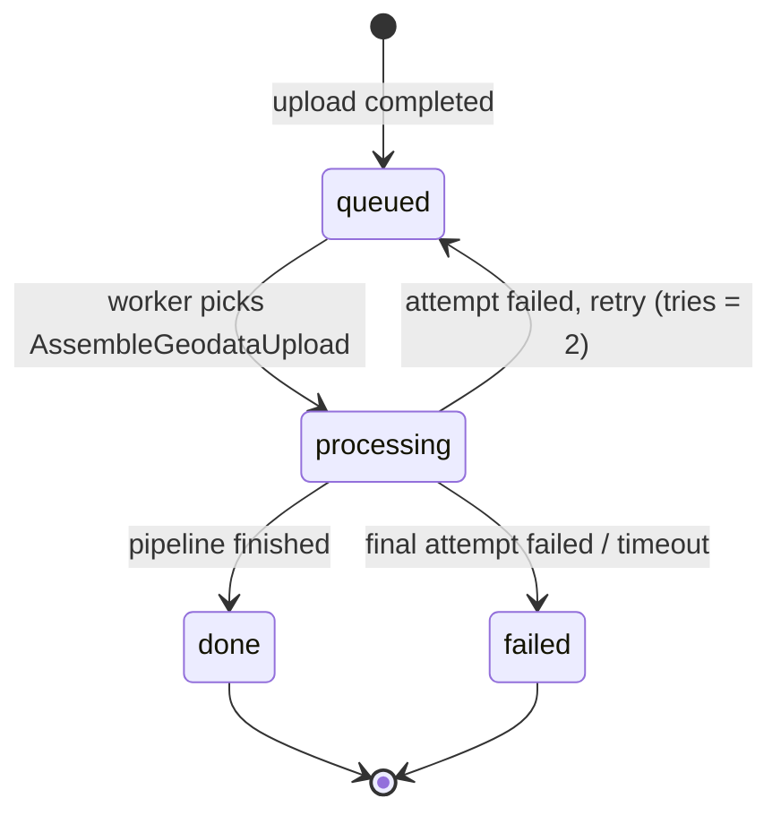
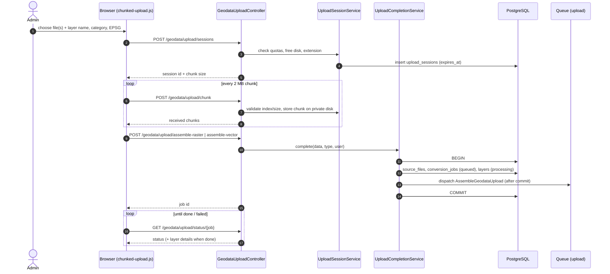
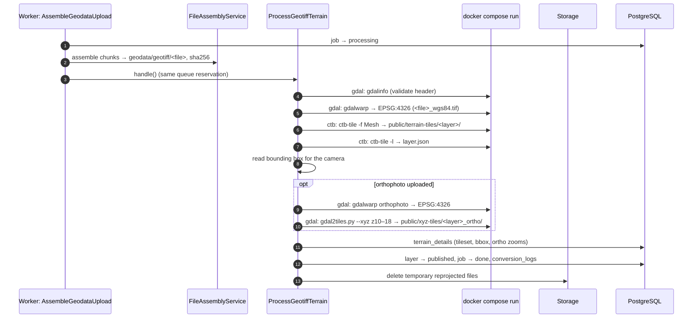
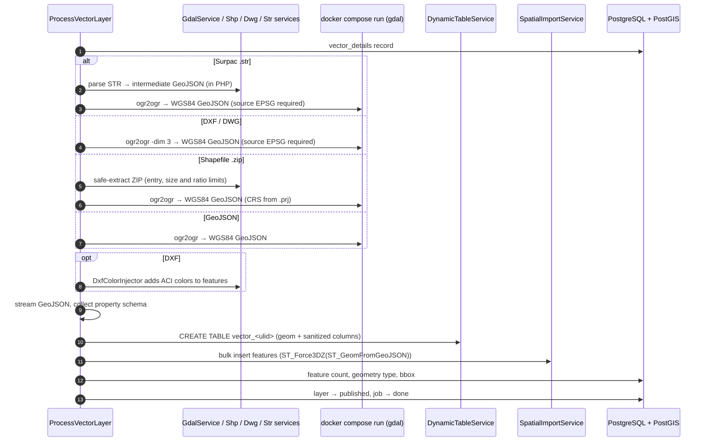
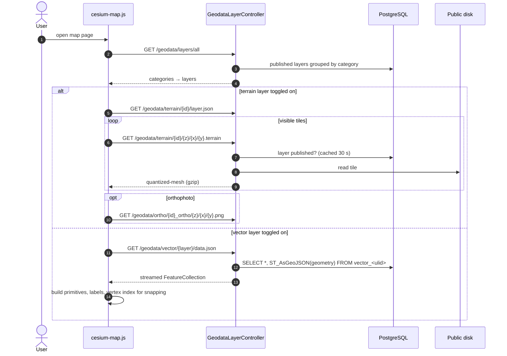
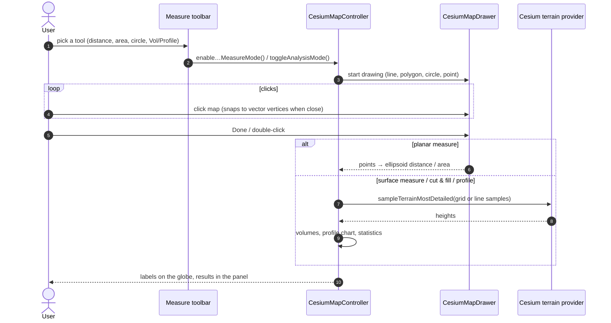
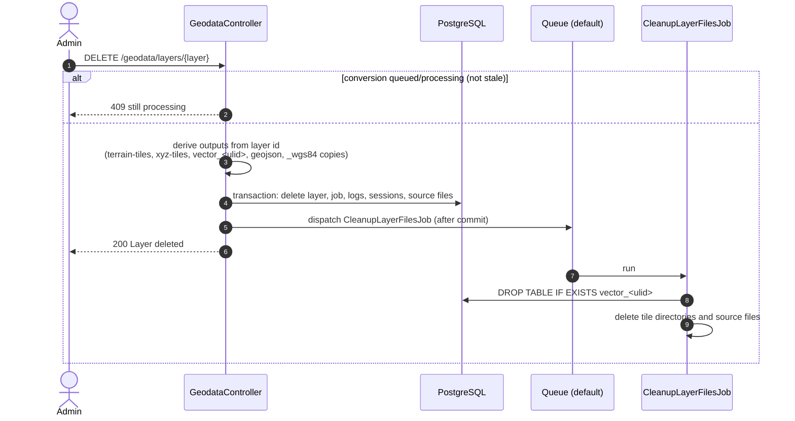

# Architecture

This document describes how Laravel CesiumJS 3D GIS Kit is put together: the moving parts, how data flows from an uploaded file to a 3D layer on the globe, and the main design decisions.

- [1. High-level overview](#1-high-level-overview)
- [2. Components](#2-components)
- [3. Data model](#3-data-model)
- [4. Lifecycles](#4-lifecycles)
- [5. Key flows (sequence diagrams)](#5-key-flows-sequence-diagrams)
- [6. Frontend architecture](#6-frontend-architecture)
- [7. Storage layout](#7-storage-layout)
- [8. Security model](#8-security-model)
- [9. Design decisions and limits](#9-design-decisions-and-limits)

## 1. High-level overview

The kit is a single Laravel application with three runtime roles:

1. **Web** (PHP-FPM or `php artisan serve`): renders Blade pages, accepts chunked uploads, and serves terrain tiles, orthophoto tiles and vector GeoJSON.
2. **Queue worker** (`php artisan queue:work`): assembles uploaded chunks and runs the conversion pipelines. It starts short-lived, network-less **Docker containers** (GDAL and Cesium Terrain Builder) for the heavy geoprocessing.
3. **Browser**: a CesiumJS globe driven by vanilla JavaScript. It also runs the measurement and terrain analysis tools entirely client-side.

What a user can do:

| Role | Map | Upload data | Manage layers & categories (dashboard) |
|---|---|---|---|
| **Admin** | View layers, measure, analyse | Yes | Yes |
| **Engineering** | View published layers, measure, analyse | No | No |

## 2. Components

### 2.1 Backend (Laravel)

| Layer | Location | Responsibility |
|---|---|---|
| Routes | `routes/web.php`, `routes/auth.php`, `routes/console.php` | All routes sit behind `auth`; uploads, deletion and the data-management dashboard additionally require `role:admin`. |
| Controllers | `app/Http/Controllers` | `HomeController` (map page), `GeodataUploadController` (chunked upload API), `GeodataLayerController` (layer lists, tile and GeoJSON serving), `GeodataController` (layer deletion), `IconController` (category icons behind auth), `Dashboard\*` (layer and category management), `ProfileController`, `Auth\*`. |
| Form requests | `app/Http/Requests` | Validation and authorization for login, profile and dashboard forms. |
| Middleware | `app/Http/Middleware/RoleCheck.php` | `role:admin,engineering` style route guards. |
| Upload services | `app/Services/Upload` | `UploadSessionService` (quotas, sessions, chunk bookkeeping), `UploadFileValidator`, `FileAssemblyService` (stitch chunks, checksum), `ShapefileArchive` (safe ZIP extraction), `GeoJsonFeatureReader` (streaming GeoJSON reader), `UploadCompletionService` (creates source file, job and layer records). |
| Conversion services | `app/Services/Conversion` | `TerrainConversionService` (gdalwarp → ctb-tile → gdal2tiles), `GdalService` (`ogr2ogr` wrapper), `ShpImportService`, `DwgImportService`, `SurpacStrParserService`, `DxfColorInjector`. |
| Database services | `app/Services/Database` | `DynamicTableService` (one PostGIS table per vector layer), `SpatialImportService` (bulk feature import). |
| Jobs | `app/Jobs` | `AssembleGeodataUpload` (queue `upload`), `ProcessGeotiffTerrain` and `ProcessVectorLayer` (extend `BaseConversionJob`), `CleanupLayerFilesJob` (queue `default`). |
| Console | `app/Console/Commands/CleanupStaleUploads.php` | Removes expired upload sessions and their chunks; scheduled every 30 minutes. |
| Models | `app/Models` | `User`, `Layer`, `LayerCategory`, `ConversionJob`, `ConversionLog`, `SourceFile`, `TerrainDetail`, `VectorDetail`, `UploadSession`. |
| Enums | `app/Enums` | `UserRole`, `LayerType`, `LayerStatus`, `JobStatus`, `SourceFileStatus`, `SourceFileType`, … |

### 2.2 Conversion toolchain

The worker never runs GDAL or CTB on the host. It calls `docker compose -f docker-compose.tools.yml run --rm <service> <command>`. Both services share the same hardening anchor:

- `network_mode: none`, `read_only: true`, `cap_drop: [ALL]`, `no-new-privileges`
- memory, CPU and PID limits (`GEODATA_CONVERTER_MEMORY`, `GEODATA_CONVERTER_CPUS`)
- they run as `GEODATA_CONVERTER_USER` so output files are owned by the PHP user
- only `storage/app/geodata`, `storage/app/public/terrain-tiles` and `storage/app/public/xyz-tiles` are mounted

| Service | Image | Used for |
|---|---|---|
| `gdal` | `ghcr.io/osgeo/gdal:ubuntu-full-latest` | `gdalwarp` (reproject DEM/orthophoto to EPSG:4326), `gdal2tiles.py` (orthophoto XYZ tiles), `ogr2ogr` (vector formats → WGS84 GeoJSON) |
| `ctb` | `tumgis/ctb-quantized-mesh:latest` | `ctb-tile` (quantized-mesh terrain tiles and `layer.json`) |

### 2.3 Frontend

Server-rendered Blade with Tailwind CSS 4 and **vanilla JavaScript** (no jQuery, Alpine.js or Preline). Vite bundles three entries: `resources/css/app.css`, `resources/js/app.js` (all pages) and `resources/js/map.js` (map page). See [section 6](#6-frontend-architecture).

## 3. Data model

Notes:

- Every vector layer gets its **own PostGIS table** named `vector_<layer ulid>`, with one sanitized column per GeoJSON property. Table and column names are generated server-side and validated against `^vector_[a-z0-9_]{1,60}$` before any DDL.
- `layers.job_id` is unique: one conversion job produces exactly one layer.
- Deleting a category moves its layers to the protected `other` category in the same transaction.

## 4. Lifecycles

### 4.1 Layer status

Only **published** layers are listed on the map and served by the tile and GeoJSON endpoints. Deleting a layer is refused (HTTP 409) while its conversion is still queued or processing, unless the job has been idle for more than three hours.

### 4.2 Conversion job status

## 5. Key flows (sequence diagrams)

### 5.1 Chunked upload and completion

Uploads are split into 2 MB chunks so large GeoTIFFs survive flaky connections and can resume. Quotas (`GEODATA_UPLOAD_MAX_SESSIONS`, `GEODATA_UPLOAD_MAX_INFLIGHT_MB`, `GEODATA_MIN_FREE_DISK_MB`) and per-user rate limits (`upload-start`, `upload-chunks`, `upload-status`) are enforced server-side.

Completion is **idempotent**: the request parameters are hashed into `upload_sessions.completion_hash`, so a retried "assemble" call returns the same job, while a call with different parameters is rejected with 409.

### 5.2 Terrain conversion (GeoTIFF DEM + optional orthophoto)

### 5.3 Vector conversion (GeoJSON, zipped Shapefile, DXF, DWG, Surpac STR)

### 5.4 Viewing a layer on the map

### 5.5 Measurement and terrain analysis (client-side)

The measure tools and the Vol/Profile panel run entirely in the browser. They sample heights from the terrain currently loaded in Cesium; no server round-trip is involved except fetching a comparison terrain list.

### 5.6 Deleting a layer

## 6. Frontend architecture

| File | Role |
|---|---|
| `resources/js/app.js` | Global helpers (`escapeHtml`, `safeColor`, `safeIconClass`, proj4 + UTM setup, number/date formatting) and UI bootstrapping. |
| `resources/js/ui-interactions.js` | Vanilla replacements for modals (`data-modal`), accordions, dropdowns, theme toggle and the off-canvas sidebar. |
| `resources/js/map.js` | Map page entry; imports the upload pipeline and the Cesium controller. |
| `resources/js/cesium-map.js` | `CesiumMapController`: viewer setup, navigation (compass, zoom, pivot camera, geolocation, coordinate picker), terrain/ortho/vector layers, measurement and Vol/Profile analysis, and the page wiring. |
| `resources/js/cesium-drawer.js` | `CesiumMapDrawer`: interactive point/line/polygon/circle drawing with undo and vertex snapping. |
| `resources/js/cesium-measure.js` | Distance, surface distance, area, surface area and circle measures built on the drawer. |
| `resources/js/upload/*` | Chunked upload client, upload modal wiring and job-status polling. |
| `resources/js/utils/*` | Constants (UTM zone from `config/geodata.php`), CSRF helper, map performance tuning, terrain provider cache, vector vertex index for snapping. |

Map lists (layers, recent uploads) are rendered from JSON with Blade components embedded in JavaScript template literals. Every user-controlled value passes through `window.escapeHtml`, and colors and icon classes are filtered through `safeColor` / `safeIconClass` before they reach `style` or `class` attributes.

Cesium's static assets (`Workers`, `Assets`, `ThirdParty`, `Widgets`) are copied from `node_modules/cesium` into `public/cesium` by the `copy-cesium-assets` plugin in `vite.config.js`, which runs at the start of every `npm run dev` / `npm run build` (skipped when the installed version is already there). `CESIUM_BASE_URL` is set to `/cesium/`.

## 7. Storage layout

| Disk / path | Contents | Public? |
|---|---|---|
| `storage/app/private/temp_chunks/<session>` | In-flight upload chunks | No |
| `storage/app/geodata/geotiff`, `…/vectors`, `…/geojson` | Assembled source files, reprojected copies, converted GeoJSON | No |
| `storage/app/public/terrain-tiles/<layer ulid>` | Quantized-mesh tiles + `layer.json` | Served through `/geodata/terrain/*` (auth + published check) |
| `storage/app/public/xyz-tiles/<layer ulid>_ortho` | Orthophoto PNG tiles | Served through `/geodata/ortho/*` (auth + published check) |
| `storage/app/public/icons/layer-categories` | Category icons (PNG/WebP only) | Served through `/geodata/icons/*` (auth) |

There is no `public/storage` symlink by design: every file goes through an authenticated route. Do not run `php artisan storage:link` in production unless you accept that tiles become reachable without login.

## 8. Security model

- **Authentication**: session-based login with username or email; logins are throttled per identifier and IP, plus a per-IP route limit. Password change and reset invalidate other sessions (`authenticateSessions()`).
- **Authorization**: two roles. Uploads, deletion and the data-management dashboard are `role:admin`; form requests re-check `canManageData()`.
- **Input handling**: upload extensions are allow-listed; ZIP extraction enforces entry count, uncompressed size and compression ratio limits; dynamic SQL identifiers are generated and pattern-checked server-side; feature values are bound parameters.
- **Isolation of untrusted files**: GDAL and CTB parse uploaded files only inside network-less, read-only, capability-dropped containers with resource limits.
- **Serving**: tiles, GeoJSON and icons are only served for published layers to authenticated users; tile routes are constrained to ULIDs and numeric z/x/y.
- **Output encoding**: Blade escaping on the server; `escapeHtml`, `safeColor` and `safeIconClass` on the client.

See [deployment.md](deployment.md#7-security-checklist) for the production checklist.

## 9. Design decisions and limits

| Decision | Why |
|---|---|
| One PostGIS table per vector layer | Keeps original attributes as real columns (queryable, typed) instead of a JSON blob, and lets each layer be dropped cleanly. |
| Converters in Docker, not on the host | GDAL/CTB parse untrusted binary formats; containers give isolation and reproducible tool versions without installing GDAL on the web server. |
| Assembly and conversion in one queue reservation | No hand-off window where a job could be lost between "assembled" and "converting". |
| Client-side measurement and analysis | Uses the exact terrain the user sees, no extra server load, works offline once tiles are cached. |
| Vanilla JS, no jQuery/Alpine/Preline | Smaller bundle, fewer moving parts for a template meant to be forked. |

Known limits:

- Converters must run on the same host as `storage/` (bind mounts are relative to the project).
- Cut & fill and profile need an active terrain layer; very large areas at fine resolution are refused client-side to keep the browser responsive.
- The terrain pipeline expects single-band DEM GeoTIFFs; LAS/LAZ, OBJ and glTF are defined in `SourceFileType` but have no pipeline yet.
