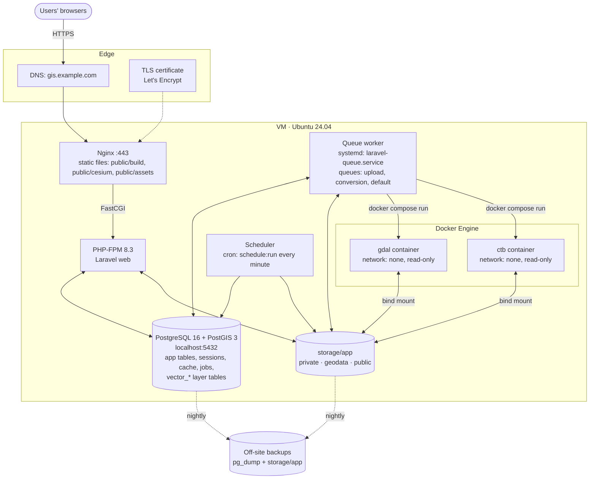
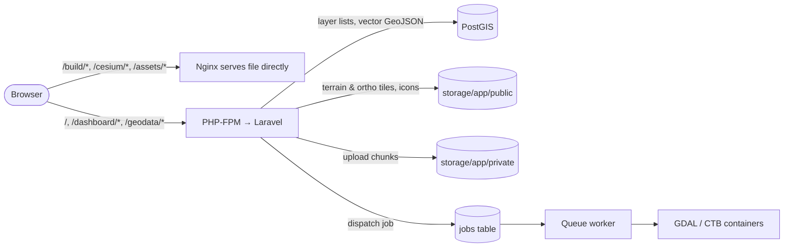
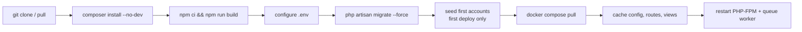

# Deployment Guide

How to run Laravel CesiumJS 3D GIS Kit in production. The reference setup is a single Linux server (Ubuntu 24.04 LTS) running Nginx, PHP-FPM, PostgreSQL + PostGIS, a supervised queue worker and Docker for the converters.

- [1. Deployment topology](#1-deployment-topology)
- [2. Server requirements](#2-server-requirements)
- [3. Install the server](#3-install-the-server)
- [4. Deploy the application](#4-deploy-the-application)
- [5. Processes: web, queue worker, scheduler](#5-processes-web-queue-worker-scheduler)
- [6. Updating a running instance](#6-updating-a-running-instance)
- [7. Security checklist](#7-security-checklist)
- [8. Backups and monitoring](#8-backups-and-monitoring)
- [9. Scaling notes](#9-scaling-notes)

## 1. Deployment topology



Everything runs on one VM: Nginx, PHP-FPM, the queue worker, the scheduler, the Docker converters and PostgreSQL. PostgreSQL listens on `localhost` only, so the database is never exposed to the network.

Why the worker and the converters share a host: `docker-compose.tools.yml` bind-mounts `./storage/app/...` relative to the project, so the containers must run where the files are. The web process and the worker must also see the same `storage/` directory.

### Request paths at a glance



## 2. Server requirements

| Resource | Minimum | Recommended | Notes |
|---|---|---|---|
| CPU | 2 vCPU | 4+ vCPU | Each converter container is limited to `GEODATA_CONVERTER_CPUS` (default 2). |
| RAM | 4 GB | 8–16 GB | Each converter is limited to `GEODATA_CONVERTER_MEMORY` (default 4 GB); add PHP-FPM and PostgreSQL on top. |
| Disk | 40 GB SSD | 200 GB+ SSD | Uploads, reprojected copies and tile pyramids grow quickly; terrain tiles are many small files (watch inodes). |
| OS | Ubuntu 22.04/24.04 or Debian 12 | | Any Linux with Docker works. |
| Software | Nginx, PHP 8.3-FPM, PostgreSQL 14+ with PostGIS 3, Docker Engine + Compose v2, Node.js 20+ (build only), Composer 2 | | |

## 3. Install the server

The commands below target Ubuntu 24.04. Adjust package names for other distributions.

```bash
sudo apt update && sudo apt install -y nginx git unzip curl \
  php8.3-fpm php8.3-cli php8.3-pgsql php8.3-mbstring php8.3-xml php8.3-zip php8.3-curl php8.3-intl php8.3-bcmath \
  postgresql postgresql-16-postgis-3
```

Install Docker Engine with the Compose plugin by following <https://docs.docker.com/engine/install/ubuntu/>, then Composer (<https://getcomposer.org/download/>) and Node.js 20+ (<https://nodejs.org>).

Create the database and user:

```bash
sudo -u postgres psql -c "CREATE USER gis WITH PASSWORD 'change-me';"
sudo -u postgres psql -c "CREATE DATABASE cesium_core OWNER gis;"
sudo -u postgres psql -d cesium_core -c "CREATE EXTENSION IF NOT EXISTS postgis;"
```

The application user (`www-data` below) needs to start converter containers:

```bash
sudo usermod -aG docker www-data
```

> Membership of the `docker` group is equivalent to root on the host. Only the queue worker needs it; keep the server dedicated to this app. A rootless Docker install for the worker user is a stricter alternative.

### PHP settings

Uploads arrive in 2 MB chunks, so PHP limits can stay small, but give some headroom (`/etc/php/8.3/fpm/conf.d/99-gis.ini`):

```ini
upload_max_filesize = 16M
post_max_size = 16M
memory_limit = 512M
max_execution_time = 120
expose_php = Off
```

### Nginx

`/etc/nginx/sites-available/gis.conf`:

```nginx
server {
    listen 80;
    server_name gis.example.com;
    return 301 https://$host$request_uri;
}

server {
    listen 443 ssl http2;
    server_name gis.example.com;
    root /var/www/laravel-cesiumjs-3d-gis-kit/public;
    index index.php;

    ssl_certificate     /etc/letsencrypt/live/gis.example.com/fullchain.pem;
    ssl_certificate_key /etc/letsencrypt/live/gis.example.com/privkey.pem;

    client_max_body_size 16M;
    add_header X-Content-Type-Options nosniff always;
    add_header X-Frame-Options SAMEORIGIN always;
    add_header Referrer-Policy strict-origin-when-cross-origin always;
    add_header Strict-Transport-Security "max-age=31536000" always;

    # Long-lived caching for hashed build files and Cesium static assets
    location ~* ^/(build|cesium)/ {
        expires 30d;
        access_log off;
        try_files $uri =404;
    }

    location / {
        try_files $uri $uri/ /index.php?$query_string;
    }

    location ~ \.php$ {
        include snippets/fastcgi-php.conf;
        fastcgi_pass unix:/run/php/php8.3-fpm.sock;
        fastcgi_param SCRIPT_FILENAME $realpath_root$fastcgi_script_name;
        fastcgi_read_timeout 120;
    }

    location ~ /\.(?!well-known) { deny all; }
}
```

```bash
sudo ln -s /etc/nginx/sites-available/gis.conf /etc/nginx/sites-enabled/
sudo nginx -t && sudo systemctl reload nginx
```

Obtain the certificate with Certbot (`sudo certbot --nginx -d gis.example.com`).

## 4. Deploy the application



```bash
sudo mkdir -p /var/www && sudo chown $USER:www-data /var/www
cd /var/www
git clone <your-repo-url> laravel-cesiumjs-3d-gis-kit
cd laravel-cesiumjs-3d-gis-kit

composer install --no-dev --optimize-autoloader
npm ci
npm run build            # also copies Cesium assets to public/cesium

cp .env.example .env
php artisan key:generate
```

Edit `.env` for production:

```dotenv
APP_NAME="Your GIS"
APP_ENV=production
APP_DEBUG=false
APP_URL=https://gis.example.com
LOG_LEVEL=warning

DB_HOST=127.0.0.1
DB_DATABASE=cesium_core
DB_USERNAME=gis
DB_PASSWORD=change-me

SESSION_SECURE_COOKIE=true
QUEUE_CONNECTION=database
DB_QUEUE_RETRY_AFTER=7500

# Match the uid:gid of www-data (check with: id www-data)
GEODATA_CONVERTER_USER=33:33
GEODATA_CONVERTER_MEMORY=4g
GEODATA_CONVERTER_CPUS=2

GIS_UTM_ZONE=49
GIS_UTM_HEMISPHERE=N

# Enable only with a working SMTP server
MAIL_SMTP_ON=false
```

Prepare storage, the database and the converter images:

```bash
sudo chown -R www-data:www-data storage bootstrap/cache
sudo chmod -R ug+rwX storage bootstrap/cache

php artisan migrate --force
php artisan db:seed --force          # first deploy only: creates admin / engineering
sudo -u www-data docker compose -f docker-compose.tools.yml pull

php artisan config:cache
php artisan route:cache
php artisan view:cache
```

Log in, then **immediately change both seeded passwords** (Edit Profile). The seeder never overwrites existing users, so later `db:seed` runs are safe.

Do not run `php artisan storage:link`: tiles and icons are served through authenticated routes on purpose.

## 5. Processes: web, queue worker, scheduler

### Queue worker (systemd)

`/etc/systemd/system/laravel-queue.service`:

```ini
[Unit]
Description=Laravel queue worker (geodata assembly & conversion)
After=network.target postgresql.service docker.service
Requires=docker.service

[Service]
User=www-data
Group=www-data
WorkingDirectory=/var/www/laravel-cesiumjs-3d-gis-kit
ExecStart=/usr/bin/php artisan queue:work --queue=upload,conversion,default --tries=2 --timeout=7200 --memory=512 --sleep=3
Restart=always
RestartSec=5
KillSignal=SIGTERM
TimeoutStopSec=7300

[Install]
WantedBy=multi-user.target
```

```bash
sudo systemctl daemon-reload
sudo systemctl enable --now laravel-queue
```

Keep `--timeout` (7200 s, the terrain job limit) below `DB_QUEUE_RETRY_AFTER` (7500 s); otherwise a long conversion is handed to a second worker while the first is still running. One worker is enough for most teams; each extra worker can run another converter container at the same time, so size RAM accordingly.

### Scheduler (cron)

Removes expired upload sessions and their chunks every 30 minutes:

```bash
sudo crontab -u www-data -e
```

```cron
* * * * * cd /var/www/laravel-cesiumjs-3d-gis-kit && php artisan schedule:run >> /dev/null 2>&1
```

## 6. Updating a running instance

```bash
cd /var/www/laravel-cesiumjs-3d-gis-kit
php artisan down --retry=60

git pull
composer install --no-dev --optimize-autoloader
npm ci && npm run build
php artisan migrate --force

php artisan config:cache && php artisan route:cache && php artisan view:cache
sudo systemctl reload php8.3-fpm
php artisan queue:restart          # worker finishes its current job, then restarts with new code

php artisan up
```

`queue:restart` waits for the current job, which can take up to two hours for a large terrain. Check `systemctl status laravel-queue` before assuming the new code is live in the worker.

## 7. Security checklist

- [ ] `APP_ENV=production`, `APP_DEBUG=false`, `LOG_LEVEL=warning` or higher.
- [ ] `composer install --no-dev`: dev tooling such as Laravel Boost must not be installed in production (with `APP_DEBUG=true` or `APP_ENV=local` it exposes an unauthenticated browser-log route).
- [ ] Seeded `admin` / `engineering` passwords changed after the first login.
- [ ] HTTPS only, `SESSION_SECURE_COOKIE=true`, HSTS header enabled.
- [ ] `storage/` and `.env` are not web-readable (Nginx `root` points to `public/`; no `public/storage` link).
- [ ] The queue worker is the only process in the `docker` group; the server is dedicated to this app.
- [ ] Converter images pinned to digests in `docker-compose.tools.yml` once you have validated a version (`image: ghcr.io/osgeo/gdal@sha256:…`).
- [ ] `GEODATA_ENABLE_PYTHON_COLOR_PARSER=false` (it parses DXF on the host, outside the container sandbox).
- [ ] Firewall: only 80/443 (and SSH) open; PostgreSQL bound to localhost (`listen_addresses = 'localhost'`, the Ubuntu default).
- [ ] Off-site backups configured and a restore tested.

## 8. Backups and monitoring

Back up both the database and the files; one without the other is not restorable (vector layers live in `vector_*` tables, terrain lives on disk).

```bash
# Database (includes every vector_* layer table)
pg_dump -Fc -d cesium_core -f /backups/cesium_core-$(date +%F).dump

# Files: source uploads, tiles, icons
tar -czf /backups/storage-$(date +%F).tar.gz -C /var/www/laravel-cesiumjs-3d-gis-kit storage/app/geodata storage/app/public
```

Watch:

- `storage/logs/laravel.log` and the dated conversion logs written by the jobs.
- `journalctl -u laravel-queue -f` for worker crashes or timeouts.
- Free disk space (uploads are refused below `GEODATA_MIN_FREE_DISK_MB`) and inode usage on the storage volume.
- Failed jobs: `php artisan queue:failed`.

## 9. Scaling notes

- **Database**: PostgreSQL can move to a managed service with PostGIS (RDS, Cloud SQL, Azure Database for PostgreSQL). Point `DB_HOST` at it; nothing else changes.
- **More conversion throughput**: run more workers on the same host, within RAM limits (each converter may use `GEODATA_CONVERTER_MEMORY`).
- **Multiple web servers**: possible only if every node shares `storage/app` (NFS or similar) and conversions still run on a host that has Docker and the same storage mounted. Sessions, cache and queue already live in PostgreSQL, so web nodes stay stateless otherwise.
- **Tile delivery**: for heavy read traffic, put a caching proxy or CDN in front of `/geodata/terrain/*` and `/geodata/ortho/*`. Responses already carry `Cache-Control: public, max-age=604800`; make sure the cache respects authentication (cache by session or restrict access at the proxy).
